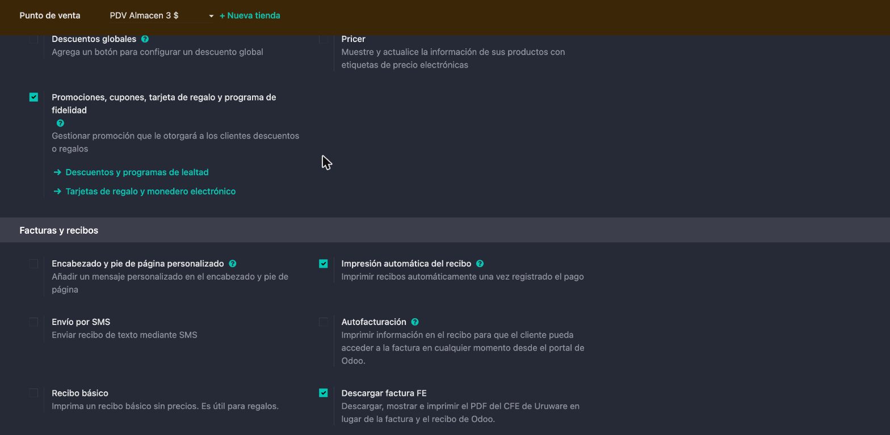
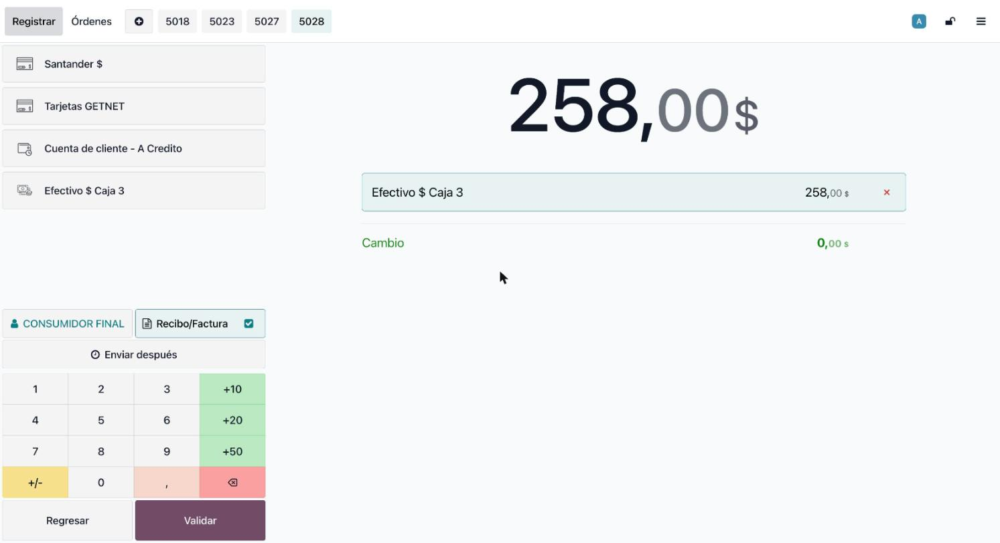
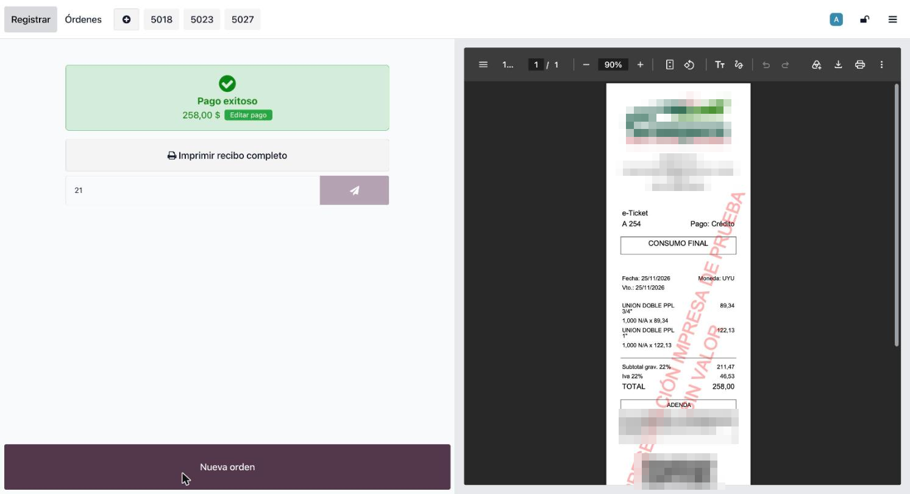
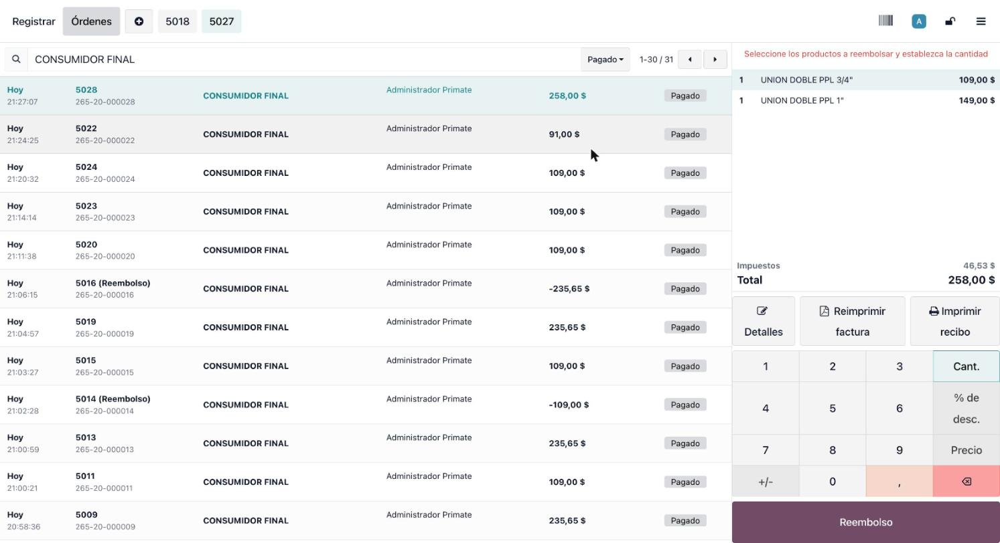
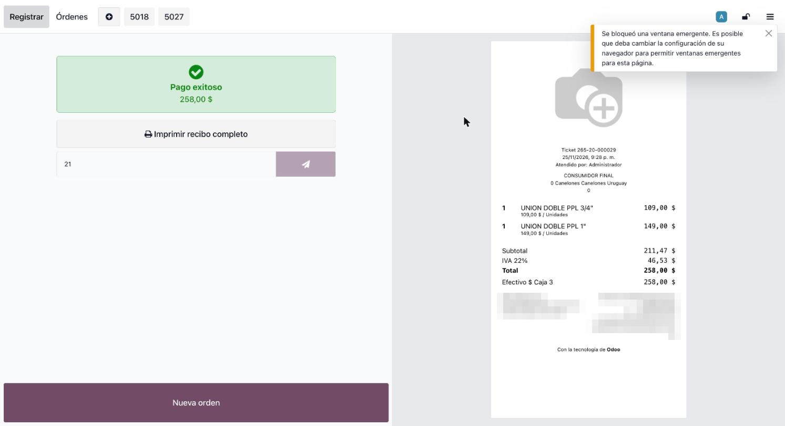
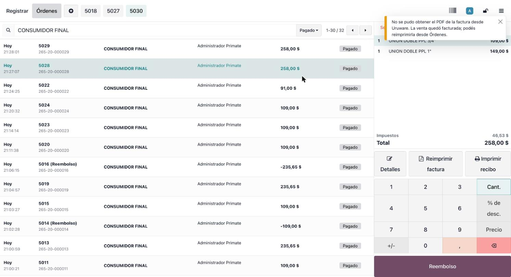

# Uruguay - PdV: imprimir CFE de Uruware (`l10n_uy_pos_cfe_print`)

Manual de uso y funcionamiento. Odoo 19 · versión del módulo 19.0.1.3.0 · issue 5256.

> Las capturas son de un entorno de prueba. Los datos de la empresa (logo, razón social,
> RUT, dirección, cuentas bancarias y QR del CFE) están pixelados.

## 1. Qué hace

En el Punto de Venta, cuando una venta se factura y el CFE queda firmado por Uruware, el
módulo usa **la representación impresa oficial del CFE que devuelve Uruware** (A4 o rollo,
según el punto de emisión) en lugar de la factura y el recibo de Odoo:

| Dónde | Con «Descargar factura FE» activo | Con el check desactivado |
|---|---|---|
| Descarga de la factura al validar la venta | PDF del CFE de Uruware | Odoo estándar |
| Botón «Reimprimir factura» en Órdenes | PDF del CFE de Uruware | Odoo estándar |
| Recibo en la pantalla «Pago exitoso» | PDF del CFE de Uruware | Recibo de Odoo |
| «Imprimir recibo completo» (y la impresión automática) | PDF del CFE de Uruware | Recibo de Odoo |
| «Imprimir recibo» en Órdenes | PDF del CFE de Uruware | Recibo de Odoo |

Con el check desactivado el módulo **no interviene**: el PdV se comporta exactamente como
Odoo estándar.

## 2. Requisitos

- Módulos: `point_of_sale` y `l10n_uy_einvoice_uruware` (LocalizacionUy).
- Facturación electrónica activa y la caja facturando (en Uruguay `l10n_uy_pos` marca
  «Recibo/Factura» por defecto).
- Navegador: ver [Recomendaciones](#7-recomendaciones-del-navegador).

## 3. Configuración

**Punto de venta → Configuración → Ajustes →** elegir la caja **→ Facturas y recibos →
«Descargar factura FE».**

- Es **por caja** y viene **activo por defecto** al instalar.
- Se guarda con «Guardar» y el PdV lo toma al recargar la pestaña (Ctrl+Shift+R). No hace
  falta reiniciar Odoo.

Opciones nativas relacionadas, en el mismo bloque:

- **Impresión automática del recibo**: al validar, imprime solo. Con el check activo
  imprime el PDF del CFE.
- **Omitir pantalla de vista previa** (debajo de la anterior, sólo visible si está activa):
  saltea «Pago exitoso» y vuelve a productos. Si está activa no se ve el CFE en pantalla.

## 4. Uso en el Punto de Venta

### 4.1 Venta facturada (check activo)

1. Cargar los productos y pasar a **Pago**. «Recibo/Factura» aparece marcado.

   

2. **Validar**. Odoo factura la venta y Uruware firma el CFE.
3. En **«Pago exitoso»**:
   - Se **descarga** el PDF del CFE (por ejemplo `101-A-254_rollo.pdf`).
   - El panel derecho muestra **el CFE de Uruware** (e-Ticket, e-Factura o nota de crédito)
     con su QR.
   - **«Imprimir recibo completo»** abre el diálogo de impresión con ese mismo PDF. Si la
     caja tiene impresión automática, se abre solo.

   

El tipo de CFE (101 e-Ticket, 111 e-Factura, 102/112 notas de crédito) lo decide la
localización según el documento del cliente. El módulo sólo muestra lo que Uruware emitió.

### 4.2 Reimprimir desde Órdenes

En **Órdenes**, filtro **Pagado**, seleccionar la venta:

- **Reimprimir factura**: descarga el PDF del CFE de Uruware.
- **Imprimir recibo**: imprime el PDF del CFE de Uruware.

Se reutiliza el PDF ya guardado: no se vuelve a pedir a Uruware.

### 4.3 Check desactivado

Todo es Odoo estándar: recibo HTML de Odoo en pantalla e impresión, y la descarga nativa
de la factura.

En la captura se ve el aviso de Chrome «Se bloqueó una ventana emergente»: es la descarga
**nativa** de Odoo, que abre el PDF con una ventana emergente. Ver
[Recomendaciones](#7-recomendaciones-del-navegador).

### 4.4 Si Uruware no responde

Si el CFE está emitido pero Uruware no devuelve el PDF (caída o corte de red):

- La venta **no se traba**: sigue a «Pago exitoso» con el recibo de Odoo.
- Aparece el aviso: *«No se pudo obtener el PDF de la factura desde Uruware. La venta
  quedó facturada; podés reimprimirla desde Órdenes.»*
- Cuando Uruware vuelva, se reimprime desde **Órdenes → Reimprimir factura**.

Si Uruware no responde **al firmar** el CFE, la venta no llega a facturarse y la
localización muestra «Erro al firmar…». Ese caso es previo a este módulo.

## 5. Cómo funciona

### 5.1 Servidor (`account.move`)

- **`get_pos_cfe_pdf()`** es el único método que llama el PdV. Devuelve
  `{'cfe_emitido': bool, 'url': str | False}`:
  - CFE no emitido → `cfe_emitido: False` y el PdV sigue con el flujo estándar de Odoo.
  - CFE emitido → URL en línea del PDF (`/web/content/<id>?access_token=…`). El PdV le
    agrega `&download=true` para descargarlo.
  - CFE emitido pero sin PDF de Uruware → `url: False` y el PdV avisa.
- **Búsqueda del PDF** (`_get_pos_cfe_pdf_attachment`), en este orden:
  1. La referencia guardada en `pos_cfe_pdf_attachment_id`.
  2. El PDF que `l10n_uy_einvoice_uruware` ya guardó al firmar (`obtener_pdf`). El nombre
     depende del formato del punto de emisión: `<CFE>`, `<CFE>_rollo.pdf`,
     `Rollo_CFE_<CFE>.pdf` o `Rollo_Alt_CFE_<CFE>.pdf`.
  3. Sólo si no existe, se pide a Uruware con `obtener_pdf()`.

  Así se hace **una sola llamada a Uruware por venta** (la de la firma) y no se duplica el
  PDF en la factura.
- El **`access_token`** hace que mostrar, imprimir o descargar no dependa de los permisos
  del cajero sobre el adjunto.
- Una caída de Uruware se registra como `WARNING` y no rompe la venta.

### 5.2 Punto de Venta (JS)

- **`PosStore.getCfePdf(accountMoveId)`**: la descarga, el panel de «Pago exitoso» y la
  impresión comparten **un único pedido por factura**. Sólo queda en memoria si hubo PDF; si
  falló, la próxima vez se reintenta.
- **`AccountMoveService.downloadPdf`**: sin el check llama al `super` nativo. Con el check
  descarga el PDF del CFE con `download()` (no con una ventana emergente).
- **`PosStore.printReceipt`**: con el check imprime el PDF del CFE en un iframe oculto. Si
  el PDF no carga en 20 s, imprime el recibo de Odoo para no trabar la validación.
- **`ReceiptScreen`**: muestra el PDF en el panel derecho cuando llega; mientras tanto (o si
  no llega) queda el recibo de Odoo.

### 5.3 Archivos

| Archivo | Qué hace |
|---|---|
| `models/account_move.py` | `get_pos_cfe_pdf` y búsqueda/obtención del PDF del CFE |
| `models/pos_config.py` | Campo `download_invoice_fe` de la caja |
| `models/res_config_settings.py`, `views/res_config_settings_views.xml` | Ajuste en Facturas y recibos |
| `static/src/app/services/pos_store.js` | Pedido único por factura e impresión del PDF |
| `static/src/app/account_move_service.js` | Descarga de la factura |
| `static/src/app/screens/receipt_screen/*` | PDF del CFE en el panel de «Pago exitoso» |
| `static/src/app/utils/print_pdf.js` | Impresión de un PDF con el diálogo del navegador |

## 6. Convivencia con otros módulos

- **`pos_invoice_auto_check`** (Campera) también decide si se descarga la factura al
  validar («Invoice Button Operation»). Las dos condiciones se combinan.
- **`pos_invoice_auto_check` reasigna el PDF a la plantilla de mail** al enviarlo
  (`template.attachment_ids = [(6, 0, …)]`): deja de figurar en los adjuntos de la factura.
  Este módulo sigue funcionando porque guarda la referencia y usa `access_token`, pero
  conviene corregirlo en `pos_invoice_auto_check`.

## 7. Recomendaciones del navegador

Para `https://<servidor>` en Chrome → Configuración del sitio:

- **Descargas automáticas: Permitir.** Sin esto, Chrome deja pasar la primera descarga y
  bloquea las siguientes.
- **Ventanas emergentes: Permitir.** Lo necesita la descarga **nativa** de Odoo (check
  desactivado). Con el check activo no hace falta.

## 8. Pruebas realizadas

Odoo 19 con una copia de la base de Campera, caja «PDV Almacen 3 $», contra el entorno de
pruebas de Uruware:

| Escenario | Check activo | Check desactivado |
|---|---|---|
| Consumidor final (e-Ticket 101) | ✅ PDF de Uruware en descarga, panel e impresión | ✅ Estándar, sin llamadas del módulo |
| Cliente con RUT (e-Factura 111) | ✅ | ✅ |
| Varias líneas, descuento y cambio | ✅ | ✅ |
| «Imprimir recibo completo» | ✅ PDF de Uruware | ✅ Recibo de Odoo |
| Órdenes: reimprimir factura y recibo | ✅ PDF reutilizado, sin pedirlo de nuevo | ✅ Estándar |
| Reembolso (nota de crédito 102) | ✅ | ✅ |
| Uruware sin respuesta (PDF) | ✅ Aviso, recibo de Odoo, sin errores | — |

Llamadas por venta con el check activo: **1** pedido del PdV al servidor y **1** a Uruware
(la de la firma).

## 9. Historial

| Versión | Cambio |
|---|---|
| 19.0.1.0.2 | El PdV descarga el CFE de Uruware en lugar del PDF de Odoo |
| 19.0.1.1.0 | Opción «Descargar factura FE» por caja; panel de «Pago exitoso» e «Imprimir recibo completo» con el CFE |
| 19.0.1.2.0 | Se reutiliza el PDF guardado al firmar; si Uruware falla, aviso en lugar de error |
| 19.0.1.3.0 | Un único pedido del PDF por factura, `access_token`, tiempo límite de impresión |
